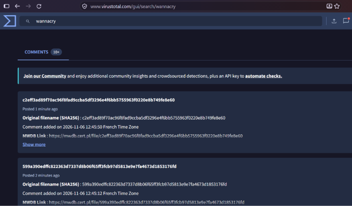
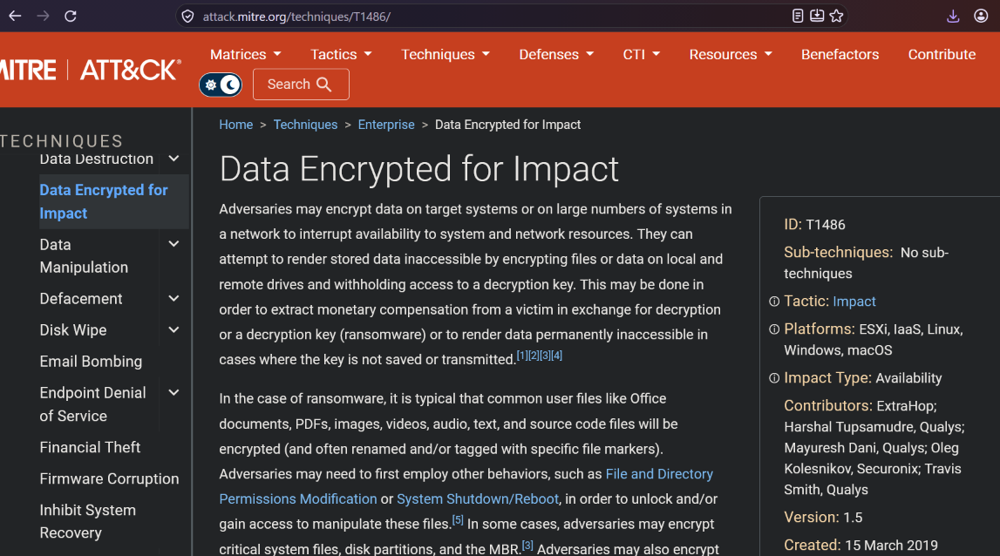
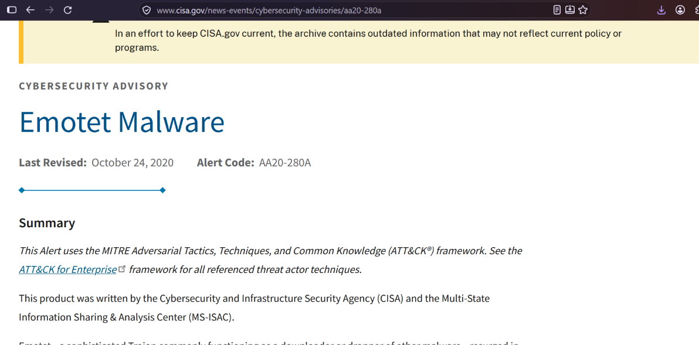
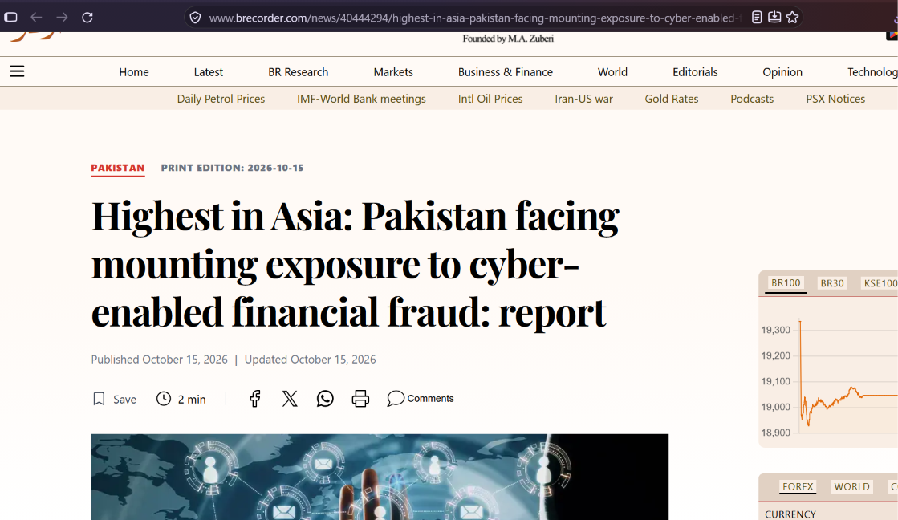
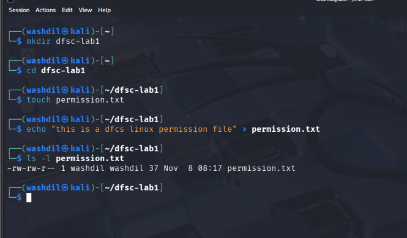
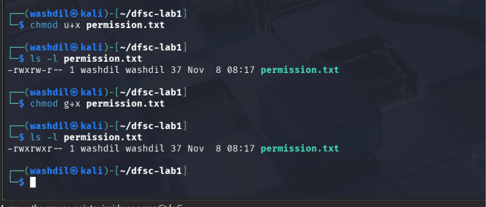
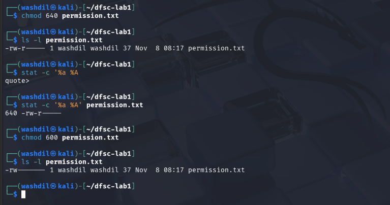
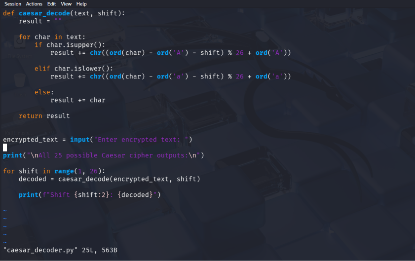
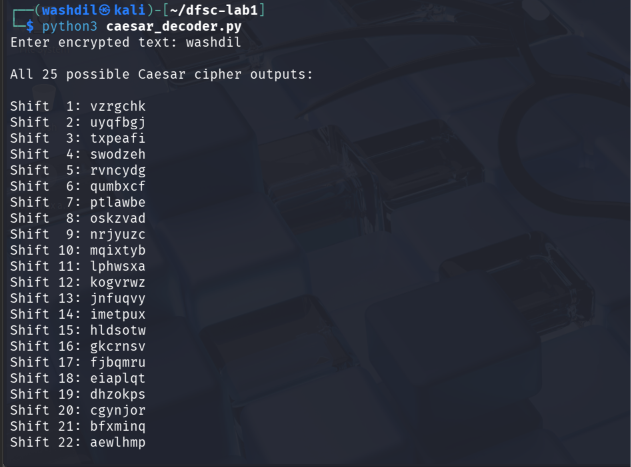

# Assignment no. 1 
**Name:** Wash Dil Khan

## Table of Contents
 - Task A: Malware Types and Examples
 - Task B: File Permissions with chmod

 # Task A (Compulsory): Malware Types and Examples

 | Type | Definition  | Named Example + Year | How It Spread | Primary Impact |
|:---|:---|:---|:---|:---|
| **Virus** | A malicious program that attaches to legitimate files and needs a user to run the infected file to spread | **ILOVEYOU** (2000) — targeted Windows users worldwide | Email attachment "LOVE-LETTER-FOR-YOU.txt.vbs" that users opened | Overwrote files with copies of itself, stole passwords, caused ~$10 billion in damage |
| **Worm** | Self-replicating malware that spreads across networks automatically without user action | **WannaCry** (2017) — targeted Windows systems globally, including NHS UK | Exploited EternalBlue vulnerability in SMBv1 (MS17-010), spread via network shares | Encrypted 200,000+ computers in 150 countries; hospitals forced to cancel operations |
| **Trojan** | Disguises as legitimate software but creates a backdoor for attackers | **Emotet** (2014) — initially targeted banks, evolved into malware dropper | Malicious email attachments and links with fake invoices | Stole banking credentials, downloaded other malware like TrickBot and Ryuk |
| **Ransomware** | Encrypts victim's files and demands payment (usually cryptocurrency) for the decryption key | **Locky** (2016) — targeted healthcare, businesses, and individuals | Email attachments with malicious macros that downloaded the payload | Encrypted files with .locky extension; demanded 0.5–1 BTC per victim |
| **Spyware** | Secretly monitors user activity, keystrokes, and communications to steal information | **Pegasus** (2016) — targeted journalists, activists, and politicians in 45+ countries | Zero-click exploits via WhatsApp and iMessage — no user interaction needed | Full device access: read messages, record calls, track location, activate camera/microphone |
| **Adware** | Displays unwanted advertisements and often tracks browsing; usually bundled with free software | **Fireball** (2017) — targeted Windows users globally, 250 million infections | Bundled with free software downloads from untrusted sites | Changed browser homepages, injected ads, tracked browsing data, downloaded more malware |
| **Rootkit** | Hides deep in the operating system to maintain privileged access while evading detection | **Stuxnet** (2010) — targeted Iranian nuclear facilities (Natanz) | USB drives + network propagation using multiple zero-days | Manipulated PLC commands to destroy centrifuges while showing operators normal readings |
| **Keylogger** | Records every keystroke to steal passwords, credit card numbers, and sensitive data | **Agent Tesla** (2014) — targeted businesses via phishing emails | Email attachments with malicious macros or exploit documents | Stole credentials from browsers, email clients, FTP applications; logged keystrokes |
| **Botnet Agent** | Turns infected machines into "zombies" controlled remotely by a botmaster for coordinated attacks | **Mirai** (2016) — targeted IoT devices (security cameras, DVRs, routers) | Scanned for devices with default/weak passwords (admin/admin, root/root) | Launched massive DDoS attacks; 1.2 Tbps attack on Dyn took down Twitter, Netflix, Spotify |
| **Fileless / Living-off-the-Land** | Uses legitimate system tools (PowerShell, WMI, mshta) to avoid writing files to disk | **Astaroth** (2019) — targeted Brazil, then expanded globally | Malicious spam with LNK shortcut files; abused wmic.exe and bitsadmin | Stole credentials, exfiltrated data via legitimate cloud services; very hard to detect |
| **Logic Bomb** | Dormant malicious code that triggers on a specific condition (date, event, or action) | **Fannie Mae** (2008) — planted by disgruntled contractor Rajendrasinh Makwana | Insider threat — planted in production server scripts before termination | Scheduled to wipe all 4,000 company servers on January 31, 2009; discovered by chance |
| **Bootkit** | Infects the Master Boot Record (MBR) or UEFI firmware to load before the operating system | **TDL4 / TDSS** (2011) — targeted Windows XP/Vista/7 globally | Drive-by downloads from compromised websites; malicious ads | Full system control from boot; invisible to most antivirus; blocked security updates |

---

## Analysis: Most Dangerous Malware Type for a Pakistani SME

> **Ransomware** poses the most immediate and existential threat to Pakistani SMEs because most small businesses lack offline backups, cannot afford extended downtime, and are therefore highly likely to pay the ransom — making them attractive, soft targets. **Spyware and keyloggers** are the second major concern, as SMEs often process customer payments, online banking, and business communications on the same poorly-patched machines that employees use for email and web browsing, creating a single point of failure for financial theft. Finally, **botnet agents** represent a silent but serious risk — a compromised SME machine can be conscripted into a botnet to attack others, leading to ISP blacklisting, bandwidth throttling, and severe reputational damage — all without the business owner ever realizing their systems were breached.

---


## Supporting Evidence Screenshots
### VirusTotal — WannaCry Sample Detectio

*figure 1.  VirusToal Showing dectectiong of WannaCry*

### MITRE ATT&CK — Data Encrypted for Impact (T1486)

*Figure 2: MITRE ATT&CK technique T1486 — the behavioral pattern used by ransomware*


### CISA Advisory — Emotet Malware

*Figure 3: CISA alert AA20-280A on Emotet trojan*

### Pakistani Business Cyberattack News

*Figure 4: News article on cyberattack affecting Pakistani financial/business sector*

---


# Task B: Practical Lab Tasks

*I have selected **Option B2** (chmod) and **Option B4** (OpenSSL) as my two tasks.*

---


# Task B2 — Linux File Permissions Using chmod

## 1. Objective

The objective of this practical exercise is to create a file in Linux, change its permissions using symbolic and octal methods, and understand how these permissions affect access for the owner, group, and other users.

## 2. Understanding Linux Permissions

Linux permissions control who can read, write, or execute a file.

| Permission | Symbol | Numeric Value | Meaning |
|---|---|---|---|
| Read | r | 4 | Read file contents |
| Write | w | 2 | Modify file contents |
| Execute | x | 1 | Execute a file |
| No permission | - | 0 | No access |

Permissions are divided into three categories:

- **Owner:** The user who owns the file.
- **Group:** Users belonging to the file's group.
- **Others:** All other users.

For example:

`rw-r--r--` = `644`

This means the owner can read and write, while the group and others can only read.

## 3. Practical Implementation

### Step 1: Create a File

```bash
mkdir dfcs-lab
cd dfcs-lab

touch permission_test.txt

echo "This is a DFCS Linux permissions test." > permission_test.txt

ls -l permission_test.txt
```

The file is created with default permissions determined by the system's umask.

**Screenshot 1 — Initial File Permissions**


*Figure 1: Creating the file and displaying its initial permissions using ls -l.*

### Step 2: Change Permissions Using Symbolic Method

```bash
chmod u+x permission_test.txt

ls -l permission_test.txt
```

This command adds execute permission to the owner.

Expected permission format:

`-rwxr--r--` or the equivalent permissions based on the initial file mode.

Next:

```bash
chmod g-w permission_test.txt

ls -l permission_test.txt
```

This removes write permission from the group.

Finally:

```bash
chmod o-r permission_test.txt

ls -l permission_test.txt
```

This removes read permission from others.

**Screenshot 2 — Symbolic Permission Changes**



*Figure 2: Applying symbolic chmod commands and verifying the permission changes.*

### Step 3: Change Permissions Using Octal Method

Now change the permissions using numeric values.

```bash
chmod 640 permission_test.txt

ls -l permission_test.txt
stat -c '%a %A' permission_test.txt
```

The resulting permissions are:

`-rw-r-----`

Explanation:

- Owner: `6 = 4 + 2` → read and write.
- Group: `4` → read only.
- Others: `0` → no permission.

Next:

```bash
chmod 600 permission_test.txt

ls -l permission_test.txt
stat -c '%a %A' permission_test.txt
```

Result:

`-rw-------`

Only the owner can read or write the file.

Finally:

```bash
chmod 644 permission_test.txt

ls -l permission_test.txt
stat -c '%a %A' permission_test.txt
```

Result:

`-rw-r--r--`

The owner has read and write access, while group and others have read-only access.

**Screenshot 3 — Octal Permission Changes**



*Figure 3: Changing permissions using octal values 640, 600, and 644 and verifying them with ls -l and stat.*

## 4. Permission Changes Summary

| Command | Octal | Owner | Group | Others | Explanation |
|---|---|---|---|---|---|
| `chmod u+x file` | Depends on original mode | Adds execute | Unchanged | Unchanged | Owner can execute the file. |
| `chmod g-w file` | Depends on original mode | Unchanged | Removes write | Unchanged | Group cannot modify the file. |
| `chmod o-r file` | Depends on original mode | Unchanged | Unchanged | Removes read | Others cannot read the file. |
| `chmod 640 file` | 640 | rw- | r-- | --- | Owner reads/writes; group reads. |
| `chmod 600 file` | 600 | rw- | --- | --- | Only owner can read/write. |
| `chmod 644 file` | 644 | rw- | r-- | r-- | Owner reads/writes; everyone else reads. |

## 5. Conclusion

This practical exercise demonstrated how Linux file permissions can be modified using symbolic and octal methods. The `chmod` command allows administrators to control file access and protect sensitive information.

The `600` permission mode is particularly useful for private files such as SSH private keys because it prevents other users from accessing them. Proper permission management is an important part of Linux security and digital forensic investigations.

---

# Task B3 — Caesar Cipher Decoder in Python

## 1. Objective

The objective of this task is to write a Python program that accepts a Caesar cipher string and displays all 25 possible shifted outputs.

A Caesar cipher is a substitution cipher in which each alphabetic character is shifted by a fixed number of positions.

For example, with a shift of +3:

`HACKER` becomes `KDFNHU`.

Since the English alphabet has 26 letters, there are only 25 meaningful non-zero shifts. Therefore, a Caesar cipher is not secure because all possible shifts can be tested quickly.

## 2. Python Implementation

Create a file named `caesar_decoder.py`.

```python
def caesar_decode(text, shift):
    result = ""

    for char in text:
        if char.isupper():
            result += chr((ord(char) - ord('A') - shift) % 26 + ord('A'))

        elif char.islower():
            result += chr((ord(char) - ord('a') - shift) % 26 + ord('a'))

        else:
            result += char

    return result


encrypted_text = input("Enter encrypted text: ")

print("\nAll 25 possible Caesar cipher outputs:\n")

for shift in range(1, 26):
    decoded = caesar_decode(encrypted_text, shift)

    print(f"Shift {shift:2}: {decoded}")
```

## 3. How the Program Works

### Step 1: Accept Input

```python
encrypted_text = input("Enter encrypted text: ")
```

The program asks the user to enter the encrypted message.

### Step 2: Process Each Character

```python
for char in text:
```

The program examines each character individually.

### Step 3: Convert Characters into Alphabet Positions

```python
ord(char)
```

The `ord()` function converts a character into its Unicode number.

For example:

- `A` = 65
- `B` = 66
- `C` = 67

### Step 4: Apply the Reverse Shift

```python
(chr((ord(char) - ord('A') - shift) % 26 + ord('A')))
```

The expression subtracts the shift, wraps around the alphabet using modulo 26, and converts the result back into a character.

### Step 5: Test All Shifts

```python
for shift in range(1, 26):
```

This loop tests every possible non-zero shift and prints the resulting message.

## 4. Sample Execution

Run the program:

```bash
python3 caesar_decoder.py
```

Enter:

```text
KDFNHU
```

Sample output:

```text
Enter encrypted text: KDFNHU

All 25 possible Caesar cipher outputs:

Shift  1: JCE MGT
Shift  2: IBDLGS
Shift  3: HACKER
Shift  4: GZBJ DQ
Shift  5: FYAI CP
...
Shift 25: L EGOIV
```

**Note:** The output shown above is illustrative. Run the program to obtain the exact output for all 25 shifts.

The correct plaintext is:

`HACKER`

This is obtained using shift 3.

**Screenshot 4 — Caesar Cipher Program**



*Figure 4: Python source code of the Caesar cipher decoder.*

**Screenshot 5 — Caesar Cipher Sample Execution**



*Figure 5: Executing the Python program with KDFNHU as input and identifying HACKER as the plaintext.*

## 5. Why 25 Tries Is Not Security

A Caesar cipher has only 25 possible non-zero shifts. An attacker can test every shift in a fraction giof a second using a simple program.

There is no meaningful protection against brute-force attacks because the key space is extremely small. Modern encryption algorithms use much larger key spaces and stronger mathematical security properties.

## 6. Conclusion

This practical exercise demonstrated how a Caesar cipher works and how Python can automate the process of decoding encrypted text.

The program successfully tests all 25 possible shifts, allowing the user to identify the original plaintext. This experiment also demonstrates why classical substitution ciphers such as Caesar are unsuitable for protecting sensitive information.

---


