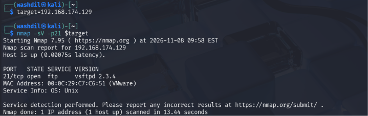
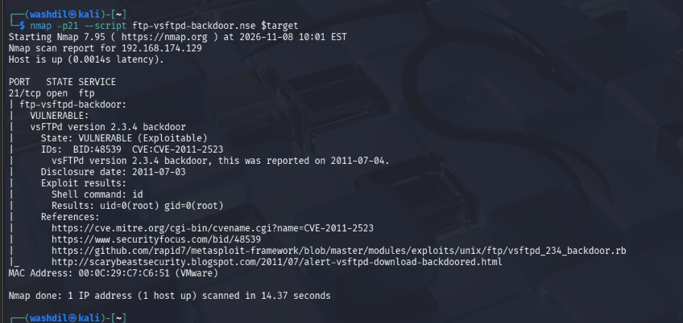
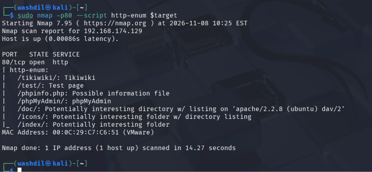
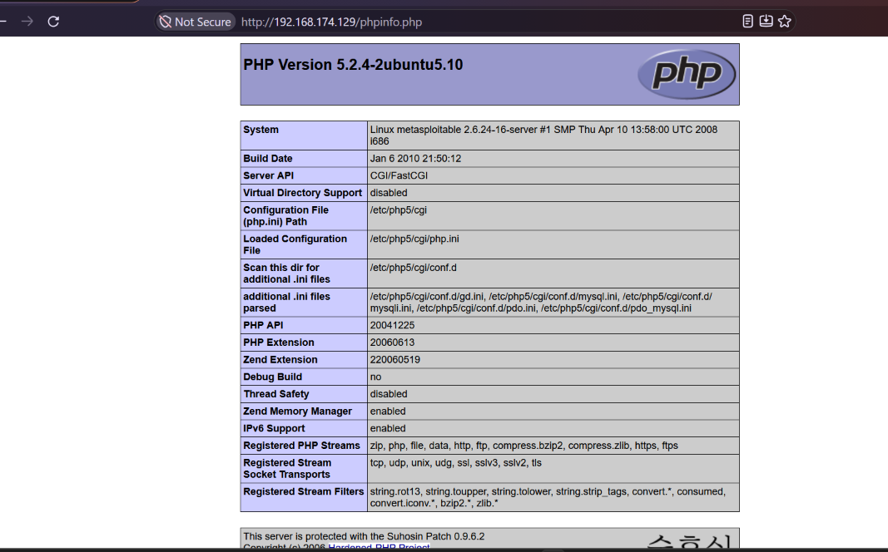
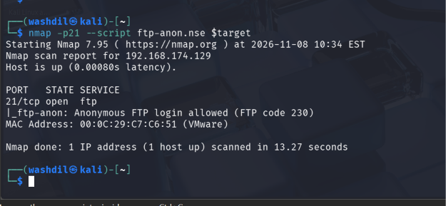
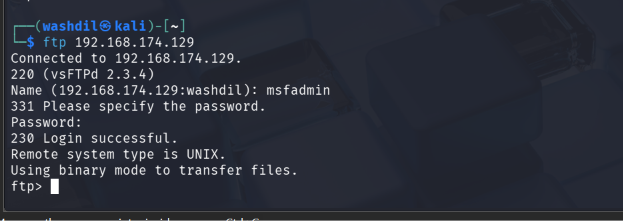

# Digital Forensics & Cyber Security Bootcamp — Day 2 Assignment
## Network, Port and Vulnerability Scanning

**Student:** Wash Dil Khan  
**Course:** Digital Forensics & Cyber Security Bootcamp  
**Assignment:** Day 2 — Scanning & Vulnerability Assessment  
**Target:** Metasploitable 2  
**Target IP:** `192.168.174.129`  
**Environment:** Kali Linux + Metasploitable 2 (isolated NAT lab)

---

# Task A — Three Complete Vulnerability Findings

## Finding 1: FTP Backdoor Command Execution in vsftpd 2.3.4

### 1. Title
FTP Backdoor Command Execution in vsftpd 2.3.4

### 2. Severity
- **CVSS v3.1:** 9.8
- **Rating:** Critical
- **CVE:** CVE-2011-2523
- **CWE:** CWE-78
- **CPE:** `cpe:/a:vsftpd:vsftpd:2.3.4`

### 3. Affected Asset

| Property | Value |
|---|---|
| IP Address | 192.168.174.129 |
| Port | 21/TCP |
| Service | FTP |
| Version | vsftpd 2.3.4 |

### 4. Description

The vsftpd 2.3.4 distribution archive released between June 30 and July 3, 2011, contained a malicious backdoor. When a specially crafted username was submitted, the backdoor could open a command shell on TCP port 6200.

This vulnerability is associated with CVE-2011-2523. It resulted from a compromised software distribution archive rather than a normal programming mistake in the original source code.

### 5. Evidence

Run the following commands in Kali Linux:

```bash
TARGET=192.168.174.129

nmap -sV -p21 $TARGET
```

Expected service identification:

```text
21/tcp open ftp vsftpd 2.3.4
```

Check the vulnerability using the Nmap script:

```bash
nmap -p21 --script ftp-vsftpd-backdoor.nse $TARGET
```

**Expected result:** Nmap may report the service as vulnerable to CVE-2011-2523.


>
> Capture the Nmap service-version output identifying vsftpd 2.3.4.

> [SCREENSHOT 2 ]

>
> Capture the vulnerability script output showing the CVE identification.


### 6. Impact

An attacker could potentially execute commands remotely without authentication. This could expose confidential information, allow modification of files, and disrupt services running on the compromised machine.

Because the target also provides database services, compromise of this host could expose additional sensitive information.

### 7. Remediation

- Replace the compromised software with a trusted, verified release.
- Download software only from trusted sources.
- Verify package signatures and checksums.
- Maintain software inventories and security updates.
- Investigate whether systems installed from compromised archives require rebuilding.

### 8. References

- Debian Security Tracker: https://security-tracker.debian.org/tracker/CVE-2011-2523
- Red Hat CVE Database: https://access.redhat.com/security/cve/CVE-2011-2523
- CVE Record: https://www.cve.org/CVERecord?id=CVE-2011-2523

---

## Finding 2: Information Disclosure Through Exposed PHP Information Page

### 1. Title
Information Disclosure Through Publicly Accessible PHP Information Page

### 2. Severity
- **Suggested rating:** Medium
- **CWE:** CWE-200 — Exposure of Sensitive Information to an Unauthorized Actor
- **CVE:** No specific CVE identified for this configuration finding.

The severity should be adjusted according to the actual information exposed and the environment.

### 3. Affected Asset

| Property | Value |
|---|---|
| IP Address | 192.168.50.129 |
| Port | 80/TCP |
| Service | HTTP |
| Resource | `/phpinfo.php` |

### 4. Description

A PHP information page may expose details about the server's PHP configuration and execution environment.

Depending on the configuration, it may reveal:

- PHP version
- Operating system information
- Loaded PHP extensions
- Environment variables
- Configuration settings
- Server paths and directory information

Such information can help an attacker understand the environment and identify additional attack opportunities.

### 5. Evidence

Run:

```bash
nmap -p80 --script http-enum 192.168.174.129
```

If the page is identified, open it in a browser:

```text
http://192.168.174.129/phpinfo.php
```

**Expected observation:** The PHP information page displays server configuration details.

> [SCREENSHOT 3 ]
> 
> Capture Nmap output identifying `/phpinfo.php`.

> [SCREENSHOT 4]
>
> Capture the PHP information page in the browser. Avoid exposing unrelated personal information.

### 6. Proof of Concept

1. Identify the HTTP service.
2. Enumerate available web resources.
3. Navigate to `/phpinfo.php`.
4. Observe the configuration information displayed without authentication.

### 7. Impact

An attacker may use the disclosed information to identify software versions, configuration weaknesses, and possible attack paths.

The page itself does not automatically provide remote code execution. Its impact depends on the information exposed and how it can be combined with other vulnerabilities.

### 8. Remediation

- Remove publicly accessible PHP information pages from production systems.
- Restrict diagnostic pages to administrators.
- Disable unnecessary diagnostic functionality.
- Review environment variables and configuration files for exposed secrets.
- Avoid displaying sensitive server configuration information to unauthenticated users.

### 9. References

- CWE-200: https://cwe.mitre.org/data/definitions/200.html
- PHP Information Documentation: https://www.php.net/manual/en/function.phpinfo.php

---

## Finding 3: Anonymous FTP Access Enabled

### 1. Title
Unauthorized File Access Through Anonymous FTP

### 2. Severity
- **Suggested rating:** Medium
- **CWE:** CWE-306 — Missing Authentication for Critical Function
- **CVE:** No specific CVE identified for this configuration finding.

The severity depends on the files accessible and whether anonymous users can modify data.

### 3. Affected Asset

| Property | Value |
|---|---|
| IP Address | 192.168.174.129 |
| Port | 21/TCP |
| Service | FTP |
| Configuration | Anonymous access enabled |

### 4. Description

Anonymous FTP permits users to access an FTP server without providing a normal personal account.

If anonymous access is enabled unnecessarily, unauthorized users may access files that should be restricted.

The risk becomes greater if the server also permits uploading, modifying, or deleting files.

### 5. Evidence

Run:

```bash
nmap -p21 --script ftp-anon.nse 192.168.174.129
```

Expected output:

```text
21/tcp open ftp
| ftp-anon: Anonymous FTP login allowed
```

> [SCREENSHOT 5 ]
> 
> Capture the Nmap anonymous FTP detection output.

Optionally verify the access in the authorized lab:

```bash
ftp 192.168.174.129
```

> SREENSHOT 6,
> 
>
Use the anonymous account if the server permits it.

### 6. Proof of Concept

1. Scan TCP port 21.
2. Run the anonymous FTP enumeration script.
3. Confirm whether anonymous authentication is accepted.
4. Record the accessible directories and files.
5. Do not upload, delete, or modify files unless the lab specifically requires it.

### 7. Impact

Unauthorized users may obtain access to files exposed by the FTP service.

If sensitive files are present, confidentiality may be affected. If anonymous upload or modification is enabled, integrity may also be affected.

### 8. Remediation

- Disable anonymous FTP unless it is explicitly required.
- Require authentication for sensitive files.
- Restrict FTP access using firewall rules.
- Apply appropriate file and directory permissions.
- Prefer secure file transfer protocols such as SFTP where appropriate.
- Monitor FTP access logs.

### 9. References

- CWE-306: https://cwe.mitre.org/data/definitions/306.html
- Nmap FTP Anonymous Script: https://nmap.org/nsedoc/scripts/ftp-anon.html

---

# Task B — Selected Optional Tasks

## B3 — Decode Every CVSS Metric for CVE-2011-2523

### CVSS Vector

```text
CVSS:3.1/AV:N/AC:L/PR:N/UI:N/S:U/C:H/I:H/A:H
```

**Base Score:** 9.8  
**Severity:** Critical

### Metric-by-Metric Explanation

| Metric | Value | Meaning | Explanation |
|---|---|---|---|
| AV — Attack Vector | N | Network | The vulnerability can be exploited remotely over a network. |
| AC — Attack Complexity | L | Low | No special conditions or complicated preparation are required. |
| PR — Privileges Required | N | None | The attacker does not need an existing account or privileges. |
| UI — User Interaction | N | None | A victim does not need to click or perform an action. |
| S — Scope | U | Unchanged | The impact remains within the vulnerable component's security authority. |
| C — Confidentiality | H | High | Successful exploitation can expose sensitive information. |
| I — Integrity | H | High | Successful exploitation can allow modification of information or system resources. |
| A — Availability | H | High | Successful exploitation can disrupt or stop services. |

### Overall Interpretation

The vulnerability is critical because an attacker can attempt exploitation remotely, without authentication or user interaction, and potentially gain significant control over the affected system.

The combination of high confidentiality, integrity, and availability impact explains the severity of the vulnerability.

### CVSS Severity Bands

| Score | Severity |
|---|---|
| 0.0 | None |
| 0.1–3.9 | Low |
| 4.0–6.9 | Medium |
| 7.0–8.9 | High |
| 9.0–10.0 | Critical |

### Reference

- NVD: https://nvd.nist.gov/vuln/detail/CVE-2011-2523

---

## B6 — The vsftpd Supply-Chain Compromise

### Introduction

The vsftpd 2.3.4 incident is an important example of a software supply-chain compromise.

A software supply-chain attack occurs when an attacker compromises a component, distribution process, repository, or delivery mechanism that users trust to obtain software.

In this incident, the compromise affected a downloadable vsftpd source archive rather than the original legitimate software development process.

### What Happened?

The vsftpd 2.3.4 archive available for download between June 30 and July 3, 2011, contained a malicious backdoor.

The backdoor was designed to activate when a specially crafted username was submitted. Once triggered, it opened a shell listener on TCP port 6200.

The vulnerability became known as:

```text
CVE-2011-2523
```

### How Was It Discovered?

The malicious behavior was identified after suspicious activity associated with the FTP service was investigated.

Security researchers examined the affected archive and identified the backdoor mechanism. The investigation established that the malicious code had been introduced into the distributed archive.

The Debian security tracker records an important distinction: the backdoored archive was not part of the normal Debian archive. The compromise affected the upstream download distribution.

### Why Was This a Supply-Chain Attack?

The incident demonstrates that trusting a software name or version is not enough.

Even when a software project is legitimate, its distribution process can be compromised.

An organization could therefore install malicious software while believing that it downloaded a normal release.

This makes software integrity verification an important security practice.

### Modern Relevance

The incident remains relevant because modern organizations depend on:

- Open-source software
- Third-party libraries
- Package managers
- Container images
- Software repositories
- Automated build systems
- External software vendors

An attacker who compromises one trusted software component may affect many downstream users.

### Security Lessons

1. Download software only from trusted sources.
2. Verify cryptographic signatures and checksums.
3. Maintain software inventories.
4. Monitor security advisories and vulnerability databases.
5. Use trusted repositories and controlled software distribution.
6. Investigate unexpected behavior in supposedly legitimate software.
7. Rebuild systems when software integrity cannot be established.

### Conclusion

The vsftpd incident demonstrates that cybersecurity is not limited to finding weaknesses in application code. It also requires protecting the software distribution process and verifying the integrity of trusted components.

A vulnerability assessment should therefore consider both technical vulnerabilities and the possibility that trusted software itself has been compromised.

### References

- Debian Security Tracker: https://security-tracker.debian.org/tracker/CVE-2011-2523
- Red Hat CVE Database: https://access.redhat.com/security/cve/CVE-2011-2523
- CVE Record: https://www.cve.org/CVERecord?id=CVE-2011-2523
- Openwall Security Discussion: https://www.openwall.com/lists/oss-security/2011/07/11/10

---
